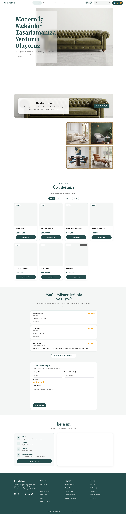

# 🛋️ Özen Koltuk – Mobilya E-Ticaret Sitesi

**Kullanılan Teknolojiler:** HTML, CSS, JavaScript (framework yok)
**Tür:** Duyarlı (responsive) ön yüz e-ticaret projesi



---

## 📌 Genel Bakış

**Özen Koltuk**, bir mobilya mağazası için hazırlanmış, mobil, tablet ve masaüstünde sorunsuz çalışan bir e-ticaret sitesidir. Saf **HTML, CSS ve JavaScript** ile yazılmıştır. Ürünler bir **yönetim panelinden** eklenir, müşteri sepete ürün atar ve **adres → kargo → ödeme** adımlarından geçerek siparişini tamamlar.

---

## 🎯 Özellikler

### Mağaza (müşteri tarafı)

- ✅ Tüm cihazlara uyumlu (mobil, tablet, masaüstü) modern tasarım
- ✅ Yukarıda sabit duran menü: arama kutusu, sepet, WhatsApp ve Instagram bağlantıları
- ✅ Kaydırırken hangi bölümde olunduğunu gösteren menü vurgusu
- ✅ Ürünleri **kategoriye göre filtreleme** ve **isimle arama**
- ✅ Ürün detay penceresi: **çoklu fotoğraf galerisi** ve **renk seçenekleri** (renk seçilince fotoğraf değişir)
- ✅ Sepet: ürün ekleme, adet arttırma/azaltma, silme, toplam tutar (sayfa yenilense de korunur)
- ✅ 3 adımlı sipariş akışı: **Adres → Kargo seçimi → Ödeme**
- ✅ Müşteri yorumları: ilk 3 yorum görünür, "Daha fazla yorum göster" ile açılır, form ile yorum eklenir
- ✅ Yorum sonrası **Google'da da paylaş** bağlantısı (isteğe bağlı)
- ✅ Google Haritalar konumu, iletişim bilgileri ve "Yol Tarifi Al" butonu

### Yönetim paneli (`admin.html`)

- ✅ Ürün **ekleme, düzenleme ve silme**
- ✅ Bir ürüne en fazla **5 fotoğraf** ekleme, kapak fotoğrafı seçme
- ✅ Fotoğrafların otomatik küçültülüp sıkıştırılması
- ✅ Ürüne **renk seçenekleri** ekleme (rengi bir fotoğrafa bağlayabilme)
- ✅ Kategori seçimi ve ürün açıklaması

---

## 🛠️ Kullanılan Teknolojiler

- **HTML5**: anlamsal sayfa yapısı
- **CSS3**: Grid ve Flexbox ile duyarlı tasarım, CSS değişkenleri
- **JavaScript (ES6)**: sepet, filtreleme, galeri penceresi, yorumlar, yönetim paneli
- **Remix Icon**: ikonlar
- **ScrollReveal**: kaydırma animasyonları
- **localStorage**: sepet, ürünler ve yorumların tarayıcıda saklanması

---

## 🚀 Başlarken

1. **Projeyi indir**

   ```bash
   git clone https://github.com/kullaniciadi/repo-adi.git
   cd repo-adi
   ```

2. **Siteyi aç**
   - VS Code'da **Live Server** eklentisiyle `index.html` dosyasını aç (önerilir)
   - Ya da `index.html` dosyasına çift tıkla

3. **Ürün eklemek için** `admin.html` sayfasını aç, ürünü kaydet ve ana sayfayı yenile.

> ⚠️ `index.html` ve `admin.html` dosyalarını **aynı yoldan** aç (ikisi de Live Server ile ya da ikisi de dosya olarak). Veriler adrese özel saklandığı için farklı yollardan açılırsa ürünler görünmez.

---

## 📂 Klasör Yapısı

```
mobilya-sitesi/
│
├── index.html        # Ana sayfa
├── styles.css        # Tüm site stilleri
├── main.js           # Sepet, arama, kategori, ürün penceresi, menü
│
├── admin.html        # Yönetim paneli
├── admin.css
├── admin.js          # Ürün ekleme / düzenleme / silme
│
├── adres.html        # Sipariş adım 1: teslimat bilgileri
├── adres.js
├── kargo.html        # Sipariş adım 2: kargo seçimi
├── kargo.js
├── odeme.html        # Sipariş adım 3: ödeme
├── odeme.style.css   # Sipariş sayfalarının ortak stili
│
└── assets/           # Görseller (header, about, screenshot vb.)
```

---

## ⚙️ Kendi Bilgilerinle Özelleştirme

| Ne                                        | Nerede                                                    |
| ----------------------------------------- | --------------------------------------------------------- |
| WhatsApp numarası (`wa.me/905XXXXXXXXX`)  | `index.html`: menü ve alt bilgi                           |
| Instagram kullanıcı adı                   | `index.html`: menü ve alt bilgi                           |
| Adres, telefon, e-posta, çalışma saatleri | `index.html`: İletişim bölümü                             |
| Harita konumu                             | `index.html`: İletişim bölümündeki `<iframe src>`         |
| Google yorum bağlantısı                   | `index.html`: `GOOGLE_REVIEW_URL`                         |
| Kargo seçenekleri ve ücretleri            | `kargo.html`                                              |
| Ürün kategorileri                         | `admin.html` (liste) ve `index.html` (kategori butonları) |
| Ana renk                                  | `styles.css`: `--primary-color`                           |

---

## ⚠️ Bilinen Sınırlamalar

- **Sunucu / veritabanı yok.** Ürünler, sepet ve yorumlar tarayıcının `localStorage` alanında saklanır. Yani bir ziyaretçinin gördüğü ürünler ve yorumlar sadece kendi tarayıcısındakilerdir. Müşterilerin hepsinin aynı ürünleri görmesi için bir veritabanı gerekir.
- **Gerçek ödeme yok.** Ödeme sayfası sadece kart bilgisinin biçimini kontrol eder, hiçbir yere göndermez ya da kaydetmez. Canlıya almadan önce iyzico, PayTR gibi bir ödeme sağlayıcısı bağlanmalıdır.
- **Yönetim paneli şifresiz.** `admin.html` herkese açıktır. Canlıda mutlaka giriş korumasıyla kullanılmalıdır.
- **Google yorumları otomatik gönderilemez.** Yorumlar müşterinin kendi Google hesabıyla yazılmalıdır, site sadece yönlendirme bağlantısı gösterir.

---

## 📈 Proje Durumu

✅ Ön yüz tamamlandı, genişletmeye hazır.

🔜 **Planlananlar**

- Ürün, yorum ve sipariş verilerinin veritabanına taşınması
- Gerçek ödeme entegrasyonu
- Yönetim paneli için kullanıcı girişi
- Siparişlerin yönetim panelinden takibi
- Google yorumlarının sitede gösterilmesi

---

## 🙌 Teşekkürler

Bu proje, MIT lisanslı **FurniShop** ön yüz şablonu (Nikita Yadav) temel alınarak geliştirilmiş ve Özen Koltuk için baştan uyarlanmıştır.

---

## 📬 İletişim

**Özen Koltuk**
📍 Mağaza adresini buraya yaz
📞 Telefon numaranı buraya yaz
📧 E-posta adresini buraya yaz
📷 Instagram: `@kullanici_adi`

---

## 🪄 Lisans

Bu proje MIT Lisansı ile açık kaynaktır, özgürce kullanılabilir.
